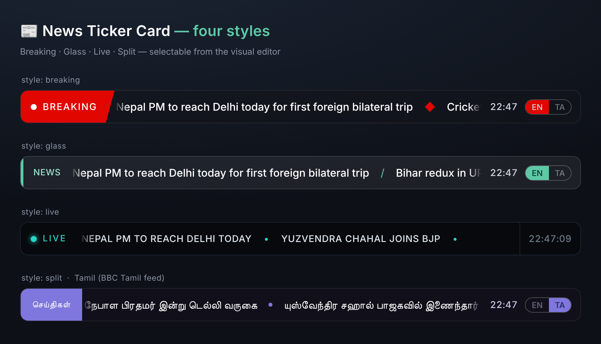
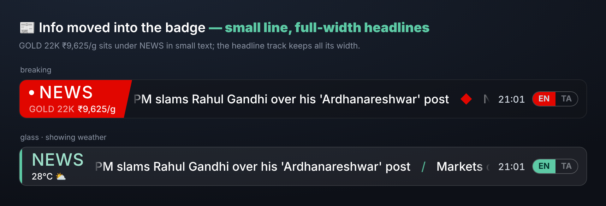

# 📰 News Ticker Card

   

A modern, broadcast-style scrolling **news ticker** card for Home Assistant dashboards. Reads headlines from a simple local JSON file, scrolls them smoothly like a TV news channel, and ships with **4 selectable styles**, a **live clock**, and a **two-language toggle** (e.g. English / Tamil) — all configurable from a built-in visual editor.



## Features

- 📺 **4 broadcast styles** — `breaking` (red chyron), `glass` (frosted, dashboard-native), `live` (cinematic dark), `split` (bold category tag). Switch from the visual editor.
- 🌍 **Two-language toggle** — a per-screen EN/TA switch that remembers your choice (`localStorage`). Works with any two languages; renders full Unicode (Tamil, Hindi, etc.).
- 🕐 **Live clock** — optional HH:MM:SS and date, updated every second.
- 🎨 **Visual editor** — style, accent colour, speed, font size, separator, clock and toggle options, all without YAML.
- 💹 **Rotating info chip** — show **gold rate, silver rate, weather, date, and location** in a slot beside the badge, cycling every few seconds. Pick which items appear from the editor.
- 📍 **Location** — set a city once; it drives the weather fetch and shows as a place label.
- ⚡ **Smooth, compositor-driven scroll** — CSS transform animation runs off the main thread, so it stays fluid even when the device is busy (e.g. decoding camera streams on a Pi).
- 🪶 **Dependency-free** — one `.js` file. No `card-mod`, no frontend libraries.

## How it works

The card itself does **not** fetch news sites directly (browser CORS blocks cross-origin RSS). Instead, a tiny server-side script (`news-generator.py`) fetches publisher RSS feeds on a schedule and writes a flat JSON array of headline strings to your `www/` folder. The card reads that same-origin file and scrolls it.

```
RSS feeds ──(cron)──> news-generator.py ──> /config/www/news_en.json  ──┐
                                           /config/www/news_ta.json  ──┴──> News Ticker Card
```

The JSON format is intentionally simple — a flat array of strings:

```json
["First headline", "Second headline", "Third headline"]
```

You can populate those files any way you like (Node-RED, an HA `command_line` sensor, your own script); `news-generator.py` is just a clean, reliable default.

### Info chip (gold / silver / weather)



The same generator also writes an `info.json` that feeds the optional rotating info chip:

```json
{
  "location": "Bangalore",
  "updated": "2026-11-22T20:10:00+05:30",
  "items": { "gold24": "₹7,846/g", "gold22": "₹7,193/g", "silver": "₹98/g", "weather": "28°C ⛅" }
}
```

- **Gold / silver** come from the public [goldprice.org](https://goldprice.org) INR spot feed, converted to per-gram (24K and 22K). These are **indicative spot prices**, not city retail rates (which add duty + making charges).
- **Weather** comes from the free, keyless [Open-Meteo](https://open-meteo.com) API, for the city set in `LOCATION`.
- **Date** is rendered by the card itself (always current, no fetch).
- **Location** is the `LOCATION` value set at the top of `news-generator.py` — change it to your city and the weather follows.

All of this uses only the Python standard library — no API keys, no pip installs.

## Installation

### 1. Add the card (HACS)

[](https://my.home-assistant.io/redirect/hacs_repository/?owner=gera-devp&repository=rss-news-ticker-card&category=plugin)

If the button doesn't work, add it manually:

1. HACS → three-dot menu → **Custom repositories**
2. URL: `https://github.com/gera-devp/rss-news-ticker-card`, category **Dashboard**
3. Install, then add the resource (HACS usually does this automatically):
   - **URL:** `/hacsfiles/rss-news-ticker-card/news-ticker-card.js`
   - **Type:** JavaScript module

**Manual install:** copy `news-ticker-card.js` into `/config/www/` and add a resource pointing at `/local/news-ticker-card.js?rev=1` (bump the `?rev=` number whenever you update, to beat browser caching).

### 2. Set up the news source

1. Copy `news-generator.py` into `/config/www/`.
2. Edit the `FEEDS` dictionary at the top — map each output file to a publisher RSS URL:

   ```python
   FEEDS = {
       "news_en.json": "https://timesofindia.indiatimes.com/rssfeedstopstories.cms",
       "news_ta.json": "https://feeds.bbci.co.uk/tamil/rss.xml",
   }
   ```

   > **Tip:** use *publisher-native* feeds (The Hindu, Times of India, BBC) rather than Google News RSS — aggregators lag the original publishers by 15–60 minutes and sort by relevance, not recency.

3. Run it once to confirm it works, then schedule it (every 15 minutes shown):

   ```bash
   python3 /config/www/news-generator.py          # test — expect "OK ... 15 headlines"
   ( crontab -l; echo '*/15 * * * * /usr/bin/python3 /config/www/news-generator.py >/dev/null 2>&1' ) | crontab -
   ```

   The script writes atomically, sets `0644` permissions so Home Assistant can read the files, and **keeps the last good file if a fetch fails** — so a throttled feed never blanks your ticker.

## Configuration

Add the card, then use the **visual editor**, or paste YAML:

```yaml
type: custom:news-ticker-card
style: glass                      # breaking | glass | live | split
news_url_en: /local/news_en.json
news_url_ta: /local/news_ta.json
speed: 70
font_size: 24
location: Bangalore
show_info: true
info_rotate_seconds: 6
info_items:
  - gold24
  - silver
  - weather
  - date
```

### Options

| Option             | Type    | Default              | Description |
| ------------------ | ------- | -------------------- | ----------- |
| `style`            | string  | `glass`              | `breaking`, `glass`, `live`, or `split` |
| `news_url_en`      | string  | `/local/news_en.json`| Path to the primary language JSON |
| `news_url_ta`      | string  | `/local/news_ta.json`| Path to the second language JSON |
| `default_lang`     | string  | `en`                 | `en` or `ta` — starting language |
| `label`            | string  | style default        | Badge text (primary language) |
| `label_ta`         | string  | `செய்திகள்`           | Badge text (second language) |
| `accent`           | string  | style default        | Badge/accent colour (hex or CSS colour); blank = style default |
| `separator`        | string  | style default        | Character between headlines |
| `speed`            | number  | `60`                 | Scroll speed in px/second |
| `font_size`        | number  | `18`                 | Headline font size (px) |
| `refresh_minutes`  | number  | `11`                 | How often the card re-reads the JSON |
| `show_clock`       | boolean | `true`               | Show the live clock |
| `clock_seconds`    | boolean | `true`               | Include seconds |
| `show_date`        | boolean | `false`              | Show the date |
| `show_label`       | boolean | `true`               | Show the badge |
| `show_lang_toggle` | boolean | `true`               | Show the EN/TA toggle |
| `pause_on_hover`   | boolean | `true`               | Pause scrolling on hover |
| `uppercase`        | boolean | `true`               | Uppercase the badge text |
| `show_info`        | boolean | `false`              | Show the rotating info chip beside the badge |
| `info_items`       | list    | `[gold24, silver, weather, date]` | Which info items to rotate. Any of: `gold24`, `gold22`, `silver`, `weather`, `date`, `location` |
| `info_rotate_seconds` | number | `6`               | Seconds each info item is shown before rotating |
| `info_position`    | string  | `badge`              | `badge` = small line under the label; `inline` = separate chip |
| `info_url`         | string  | `/local/info.json`   | Path to the info JSON written by the generator |
| `location`         | string  | `""`                 | Place label for the `location` chip; blank falls back to `info.json`'s location |

## Prerequisites

- Home Assistant 2024.1+
- `python3` available where the generator runs (standard library only — no pip installs)

## License

MIT — see [LICENSE](LICENSE).
